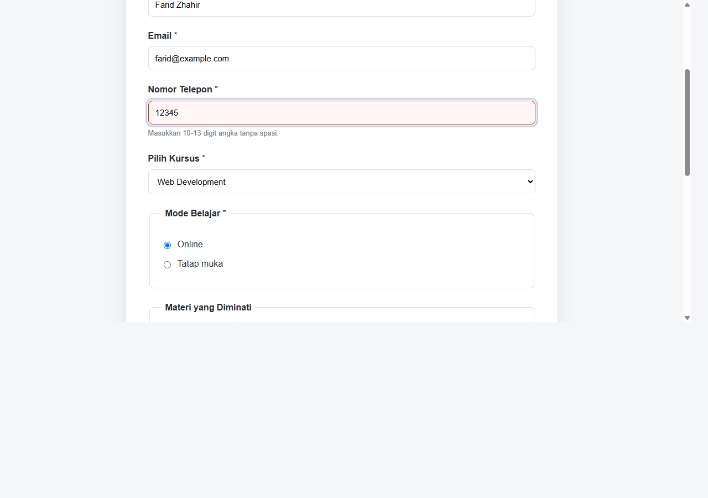
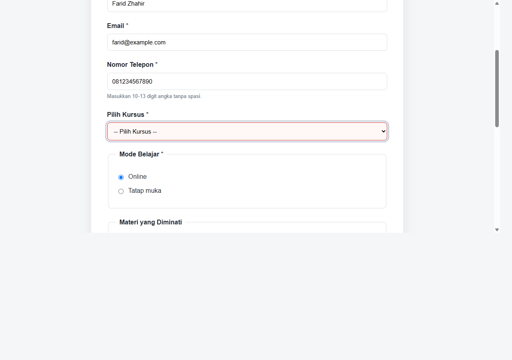
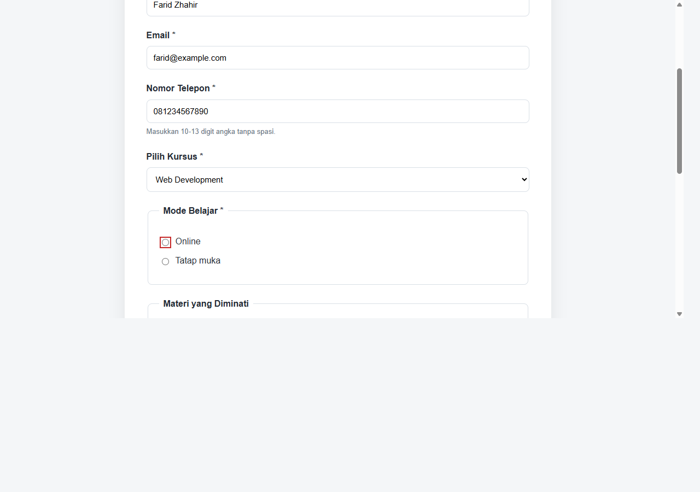
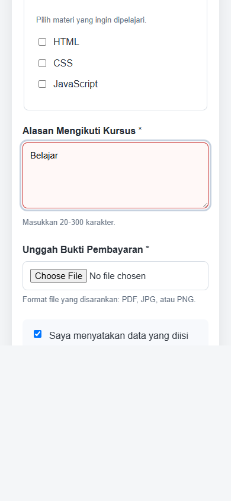
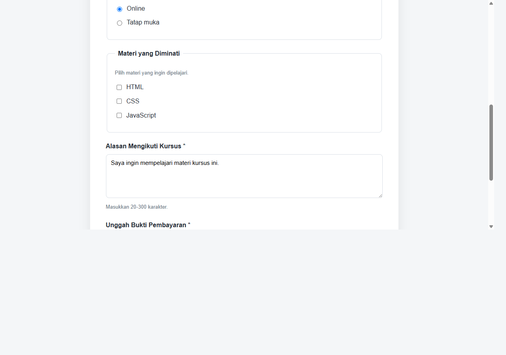

# Form Pendaftaran Kursus — Pertemuan 8

## Tugas

Membuat form pendaftaran kursus menggunakan radio button, checkbox, select,
textarea, dan upload bukti pembayaran. Form menyediakan tombol `button`,
`submit`, dan `reset`, minimal empat aturan validasi, serta pengujian lima
skenario input salah.

## Berkas

- `tugas.html` — struktur form dan validasi HTML.
- `css/style.css` — tampilan form desktop dan mobile.
- `dokumentasi/screenshots/` — screenshot pengujian input yang tidak valid.

## Validasi form

1. Nama wajib diisi dan terdiri dari 3-60 karakter.
2. Email wajib diisi dengan format email.
3. Nomor telepon wajib terdiri dari 10-13 digit angka.
4. Kursus dan mode belajar wajib dipilih.
5. Alasan mengikuti kursus wajib diisi, minimal 20 dan maksimal 300 karakter.
6. Bukti pembayaran wajib dipilih; `accept` menyarankan format PDF, JPG, JPEG,
   atau PNG.
7. Persetujuan wajib dicentang.

Validasi menggunakan atribut HTML seperti `required`, `type`, `minlength`,
`maxlength`, `pattern`, dan `accept`. Tombol **Periksa Form** menampilkan
validasi bawaan browser tanpa mengirim form.

## Test case validasi

| No. | Field | Input uji | Hasil yang diharapkan | Hasil aktual |
| --- | --- | --- | --- | --- |
| 1 | Nomor telepon | `12345` | Nomor ditandai tidak valid karena kurang dari 10 digit. | Gagal validasi field (`checkValidity() = false`). |
| 2 | Kursus | Tidak memilih kursus | Kursus ditandai tidak valid. | Gagal validasi field (`checkValidity() = false`). |
| 3 | Mode belajar | Tidak memilih radio | Mode belajar ditandai tidak valid. | Gagal validasi field (`checkValidity() = false`). |
| 4 | Alasan mengikuti kursus | `Belajar` | Alasan ditandai tidak valid karena kurang dari 20 karakter. | Gagal validasi field (`checkValidity() = false`). |
| 5 | Bukti pembayaran | Tidak memilih file | Bukti pembayaran ditandai tidak valid. | Gagal validasi field (`checkValidity() = false`). |

## Validasi di server

Validasi browser dapat dilewati. Server tetap wajib memeriksa field wajib,
format email dan nomor telepon, pilihan kursus dan mode belajar, panjang
alasan, persetujuan, serta keberadaan, ukuran, dan tipe file bukti pembayaran.
Atribut `accept` hanya membantu pemilihan file di browser dan bukan pemeriksaan
tipe file di server.

## Perubahan, masalah, dan solusi

Form pendaftaran kursus dibuat mengikuti elemen dan validasi HTML pada modul.
Lima skenario input tidak valid diuji menggunakan validasi bawaan browser.
Screenshot pengujian disimpan di `dokumentasi/screenshots/`.

## Screenshot hasil pengujian

### Desktop — Nomor telepon tidak valid

### Desktop — Kursus belum dipilih

### Desktop — Mode belajar belum dipilih

### Mobile — Alasan mengikuti kursus terlalu singkat

### Desktop — Bukti pembayaran belum dipilih

