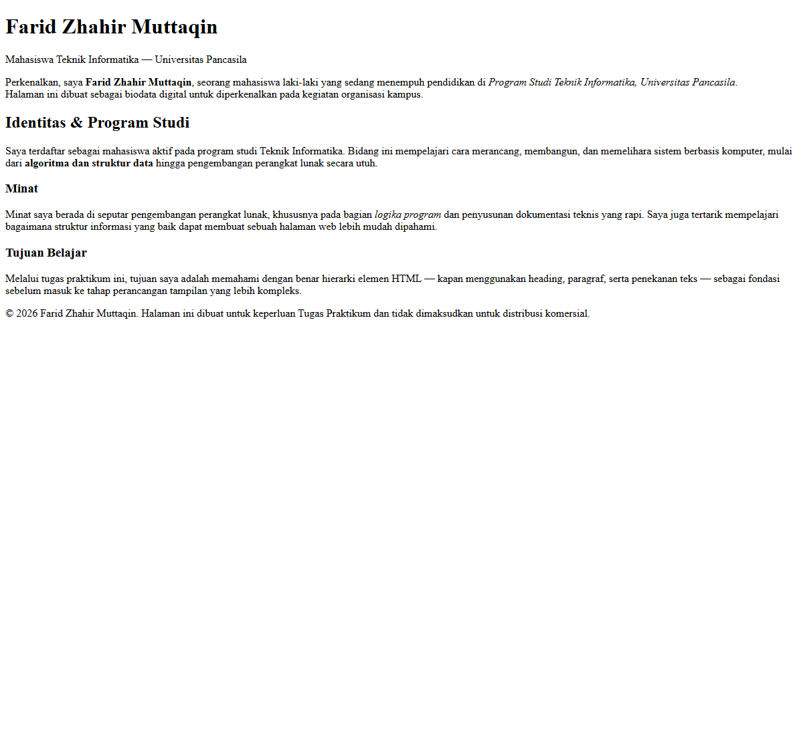

# Laporan Praktikum Web

## Identitas Tugas

- Nama: Farid Zhahir Muttaqin
- NIM: 4525210105
- Mata kuliah: Praktikum Desain Web
- Pertemuan: 1
- Tema: Biodata pribadi

## Judul Program

**Biodata Farid Zhahir Muttaqin**

## Tujuan

Membuat halaman biodata sederhana menggunakan HTML serta memahami struktur
dasar dokumen HTML dan penggunaan elemen teks.

## Struktur Folder

```text
pertemuan01/
|-- Tugas1.html
|-- images/
|   `-- hasil-running.png
`-- Readme.md
```

## Isi Program

Halaman biodata berisi beberapa bagian utama:

1. **Perkenalan** berisi nama, program studi, universitas, dan tujuan halaman.
2. **Identitas dan Program Studi** menjelaskan status sebagai mahasiswa serta
   gambaran bidang Teknik Informatika.
3. **Minat** menjelaskan ketertarikan pada pengembangan perangkat lunak dan
   dokumentasi teknis.
4. **Tujuan Belajar** menjelaskan tujuan mempelajari hierarki elemen HTML.
5. **Footer** berisi informasi hak cipta dan keterangan penggunaan halaman.

## Elemen HTML yang Digunakan

- Struktur dokumen HTML5: `doctype`, `html`, `head`, dan `body`.
- Elemen metadata `meta` untuk encoding karakter dan tampilan responsif.
- Heading `h1`, `h2`, dan `h3` untuk menyusun hierarki judul.
- Paragraf `p` untuk menampilkan informasi biodata.
- Elemen `strong` dan `em` untuk penekanan teks.
- Elemen `br` untuk pindah baris.
- Elemen `main` dan `footer` untuk menyusun bagian utama halaman.

## Dokumentasi Screenshot

Screenshot proses coding belum tersedia.

### Hasil Running

Screenshot halaman biodata disimpan di folder `images`.


