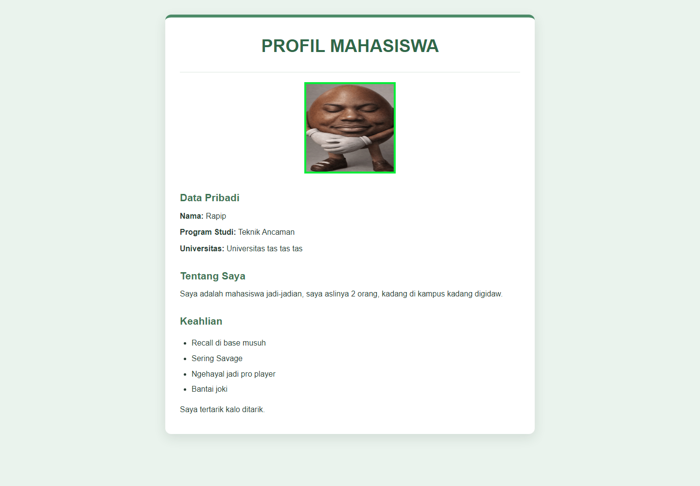
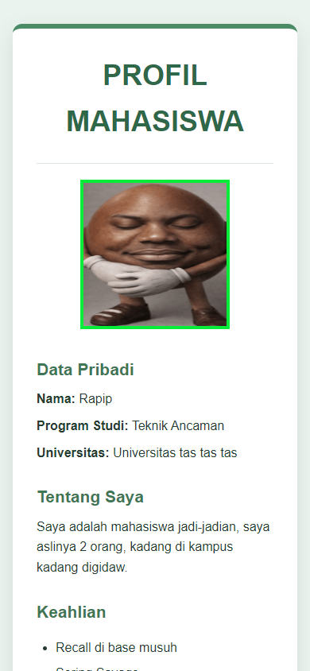
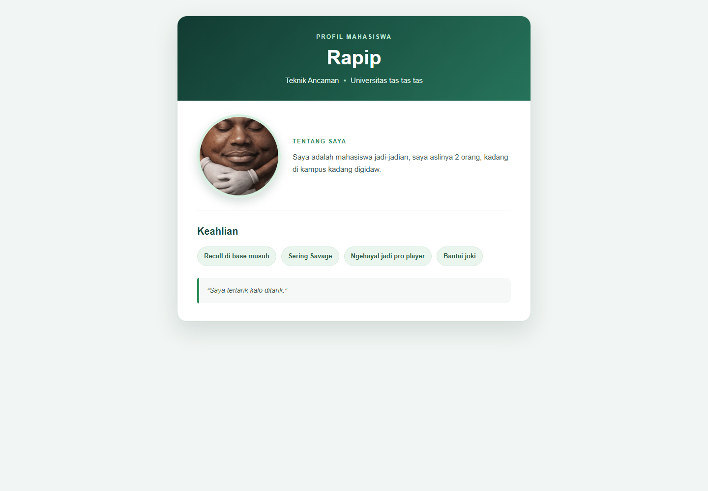
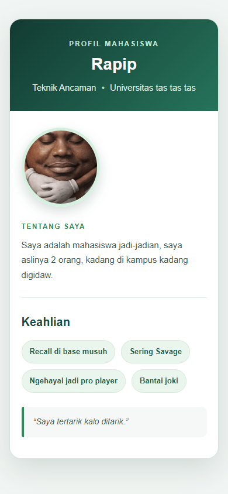

# Modifikasi Profil Mahasiswa — Pertemuan 3

## Tujuan

Memperbarui halaman profil mahasiswa menggunakan CSS inline, tanpa stylesheet
eksternal. Informasi profil dan daftar keahlian tetap dipertahankan.

## Berkas

- `../index-sebelum.html` adalah halaman sebelum modifikasi.
- `../tugas.html` adalah halaman sesudah modifikasi.

## Perubahan

Tampilan sesudah menggunakan lebih dari 10 properti CSS inline untuk mengatur
latar, kartu profil, jarak, tipografi, foto, daftar keahlian, dan kutipan.
Warna memakai beberapa format: nama warna (`white`, `seagreen`), HEX, RGB,
RGBA, dan HSL. Foto dibuat bundar, informasi dikelompokkan dengan hierarki
yang lebih jelas, dan daftar keahlian ditampilkan sebagai label.

## Masalah dan solusi

CSS inline membuat setiap elemen dapat ditata langsung, tetapi aturan yang
berulang lebih sulit dirawat. Untuk latihan ini seluruh gaya tetap ditulis
inline sesuai ketentuan; jarak dan warna dibuat konsisten agar halaman tetap
mudah dibaca. Layout foto dan informasi dapat membungkus ke baris berikutnya
pada layar sempit.

## Dokumentasi sebelum dan sesudah

### Sebelum — Desktop

### Sebelum — Mobile

### Sesudah — Desktop

### Sesudah — Mobile

