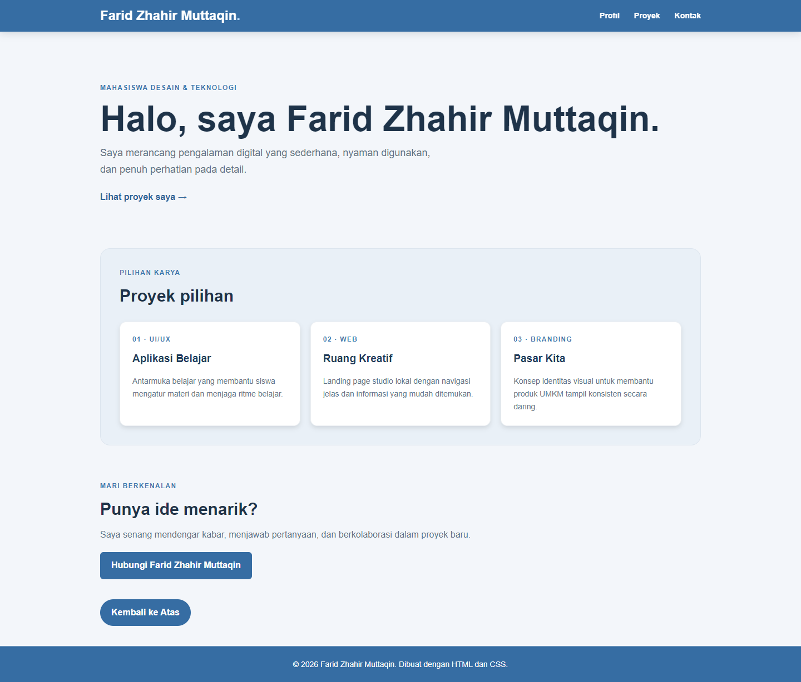
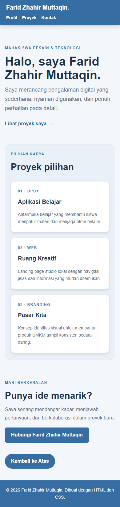

# Halaman Profil — Pertemuan 4

## Tujuan

Membangun ulang halaman profil/portofolio dalam dua berkas terpisah:
`../index.html` dan `../css/style.css`.

## Penerapan

- Box model diterapkan melalui `box-sizing: border-box`, padding, border,
  dan margin pada kontainer, kartu, tombol, serta bagian halaman.
- Class reusable `.card` digunakan pada tiga kartu proyek, sedangkan `.button`
  digunakan kembali untuk tautan aksi.
- Header memakai Flexbox; daftar proyek memakai CSS Grid.
- Media query `max-width: 767px` menyesuaikan header, navigasi, dan kartu
  menjadi satu kolom untuk layar kecil.

## Perubahan, masalah, dan solusi

Profil dibuat lebih terstruktur dengan bagian perkenalan, proyek, dan kontak.
Kartu yang berjajar dapat terasa sempit pada ponsel; grid diubah menjadi satu
kolom pada breakpoint mobile. Header dan navigasi juga diizinkan membungkus
agar tetap terbaca tanpa membuat halaman melebar.

## Bukti

### Desktop

### Mobile

