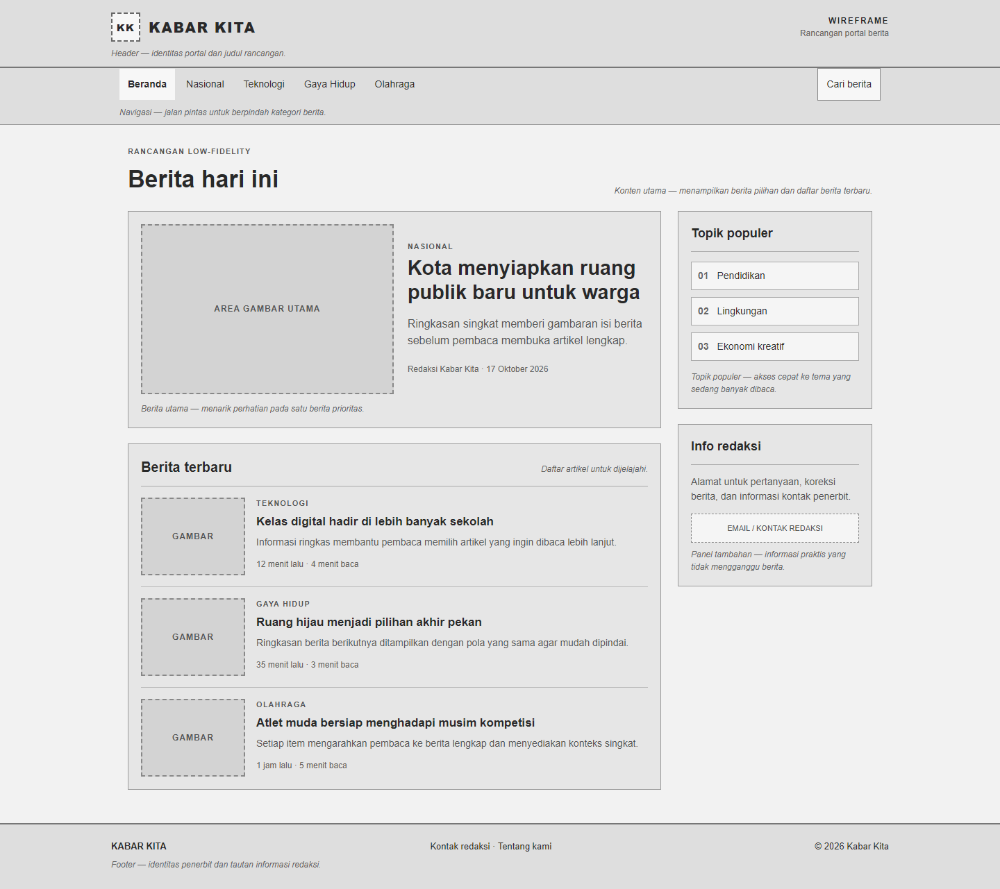
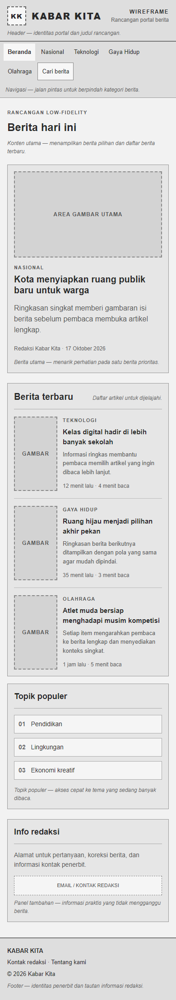

# Wireframe Portal Berita — Pertemuan 5

## Pilihan studi kasus

Portal berita **Kabar Kita**, dengan wireframe low-fidelity responsif untuk
desktop dan ponsel. Buka `../tugas.html` untuk melihat rancangan dan anotasi
fungsi setiap area.

## Isi wireframe

- Header memuat identitas portal dan nama rancangan.
- Navigasi mengelompokkan kategori berita.
- Area berita utama menonjolkan satu artikel dan ringkasannya.
- Daftar berita terbaru memakai pola kartu yang konsisten.
- Panel samping berisi topik populer dan informasi redaksi.
- Footer menampilkan identitas penerbit dan kontak.
- Anotasi pada setiap area menjelaskan peran elemen dalam rancangan.

## Perubahan, masalah, dan solusi

Rancangan desktop memakai dua kolom untuk berita dan informasi tambahan.
Pada layar kecil, kolom diubah menjadi satu kolom, navigasi dapat membungkus,
dan kartu berita menyesuaikan lebar. Placeholder gambar sengaja dipertahankan
agar struktur dan kebutuhan konten terlihat tanpa membuat mockup visual
beresolusi tinggi.

## Ringkasan (150–250 kata)

Wireframe Kabar Kita merangkum rancangan awal portal berita sebelum visual
final dan pengembangan aplikasi dibuat. Pada desktop, header menampilkan nama
portal, lalu navigasi menyediakan kategori yang dapat dipilih pembaca. Area
konten utama memakai dua kolom: kolom pertama memprioritaskan berita utama
serta daftar berita terbaru, sedangkan kolom kedua menyediakan topik populer
dan informasi redaksi. Placeholder gambar menunjukkan area media yang perlu
disediakan oleh tim konten. Setiap bagian diberi anotasi singkat agar fungsi
dan prioritas informasinya mudah didiskusikan bersama klien.

Masalah utama pada rancangan portal berita adalah banyaknya jenis konten yang
harus ditampilkan tanpa membuat berita utama kehilangan perhatian. Berita
utama diberi area paling besar, sementara daftar artikel menggunakan pola
kartu berulang agar mudah dipindai. Masalah berikutnya adalah lebar layar
ponsel yang tidak cukup untuk dua kolom. Solusinya, media query menyusun
konten menjadi satu kolom, mengecilkan jarak dan placeholder, serta
membungkus navigasi. Dengan demikian, urutan informasi tetap jelas dan
pengguna tidak perlu menggulir secara horizontal. Wireframe ini sengaja
menggunakan warna netral dan komponen sederhana supaya perubahan susunan
konten dapat dibahas dengan biaya rendah sebelum masuk ke desain visual dan
implementasi.

## Struktur

```text
tugas/
|-- tugas.html
|-- css/
|   `-- style.css
`-- dokumentasi/
    `-- Readme.md
```

## Screenshot

### Desktop



### Mobile


