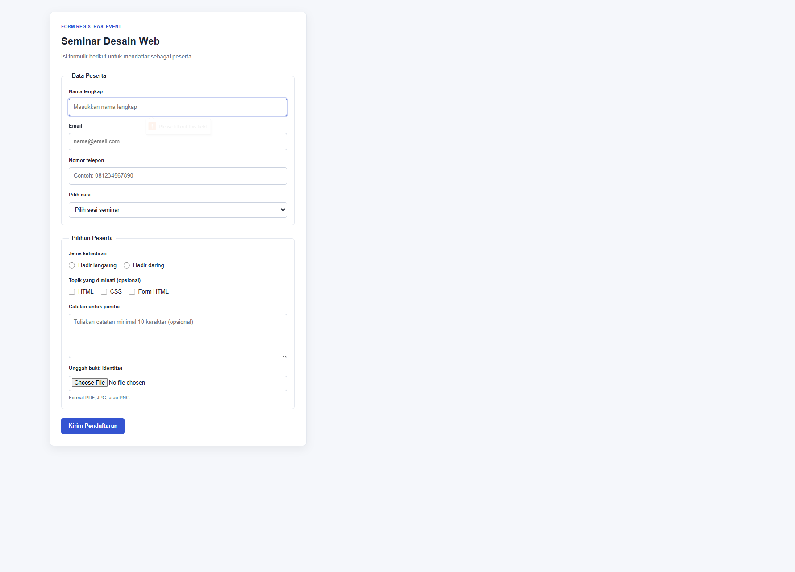
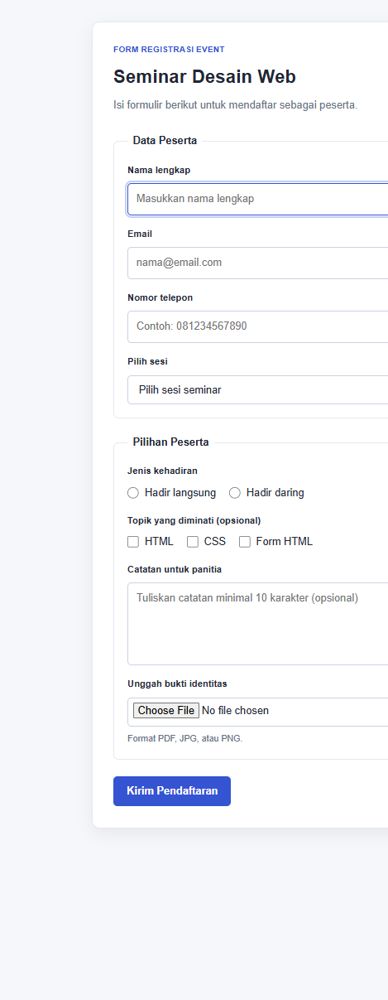

# Form Registrasi Event — Pertemuan 7

## Tugas

Membuat form registrasi event dengan radio, checkbox, select, textarea, dan
upload. Form dilengkapi validasi, pengujian minimal lima skenario input salah,
serta penjelasan validasi yang tetap harus dilakukan di server.

## Berkas

- `tugas.html` — struktur form registrasi dan validasi HTML.
- `css/style.css` — tampilan form desktop dan mobile.
- `dokumentasi/screenshots/` — screenshot form pada skenario input salah.

## Validasi form

1. Nama wajib diisi dan terdiri dari 3–60 karakter.
2. Email wajib diisi dengan format email.
3. Nomor telepon wajib terdiri dari 10–13 digit angka.
4. Sesi wajib dipilih.
5. Salah satu pilihan kehadiran wajib dipilih.
6. File bukti identitas wajib diunggah; pilihan format dibatasi ke PDF, JPG,
   JPEG, atau PNG.
7. Catatan bersifat opsional; jika diisi, panjangnya 10–300 karakter.

Validasi tersebut menggunakan atribut HTML, seperti `required`, `type`,
`minlength`, `maxlength`, `pattern`, dan `accept`. Radio dipakai untuk satu
pilihan kehadiran, checkbox untuk topik yang diminati, select untuk sesi,
textarea untuk catatan, serta file input untuk bukti identitas.

## Test case validasi

| No. | Field | Input uji | Hasil yang diharapkan | Hasil aktual |
| --- | --- | --- | --- | --- |
| 1 | Nama | Kosong | Form ditolak; nama wajib diisi. | Form ditolak oleh validasi browser. |
| 2 | Email | `farid@` | Form ditolak; format email tidak valid. | Form ditolak oleh validasi browser. |
| 3 | Nomor telepon | `12345` | Form ditolak; harus 10–13 digit angka. | Form ditolak oleh validasi browser. |
| 4 | Sesi | Tidak memilih sesi | Form ditolak; sesi wajib dipilih. | Form ditolak oleh validasi browser. |
| 5 | Kehadiran | Tidak memilih radio | Form ditolak; jenis kehadiran wajib dipilih. | Form ditolak oleh validasi browser. |
| 6 | Bukti identitas | Tidak mengunggah file | Form ditolak; bukti identitas wajib diunggah. | Form ditolak oleh validasi browser. |
| 7 | Catatan | `Halo` | Form ditolak jika catatan diisi kurang dari 10 karakter. | Form ditolak oleh validasi browser. |

## Validasi di server

Validasi HTML di browser dapat dilewati, sehingga server tetap wajib memeriksa
field wajib, format email, panjang dan format nomor telepon, pilihan sesi dan
kehadiran, serta panjang catatan. Server juga harus memeriksa keberadaan,
ukuran, dan tipe file yang diunggah; atribut `accept` hanya membantu
membatasi pilihan file pada browser dan bukan pemeriksaan keamanan.

## Screenshot

### Desktop



### Mobile



## Struktur

```text
tugas/
|-- tugas.html
|-- Readme.md
|-- css/
|   `-- style.css
`-- dokumentasi/
    `-- screenshots/
        |-- desktop.png
        `-- mobile.png
```
