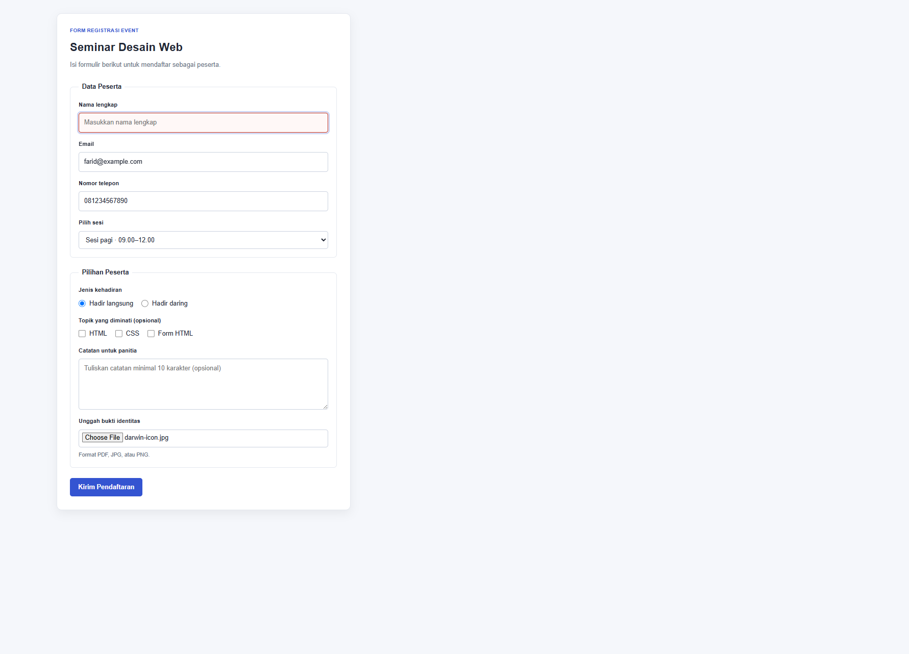
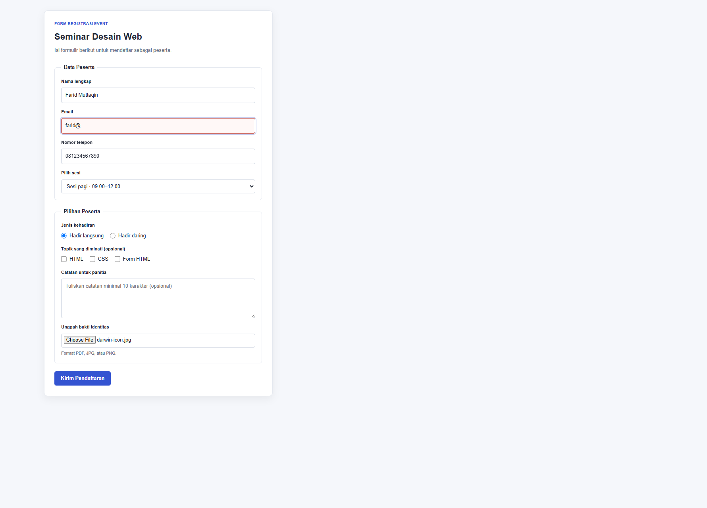
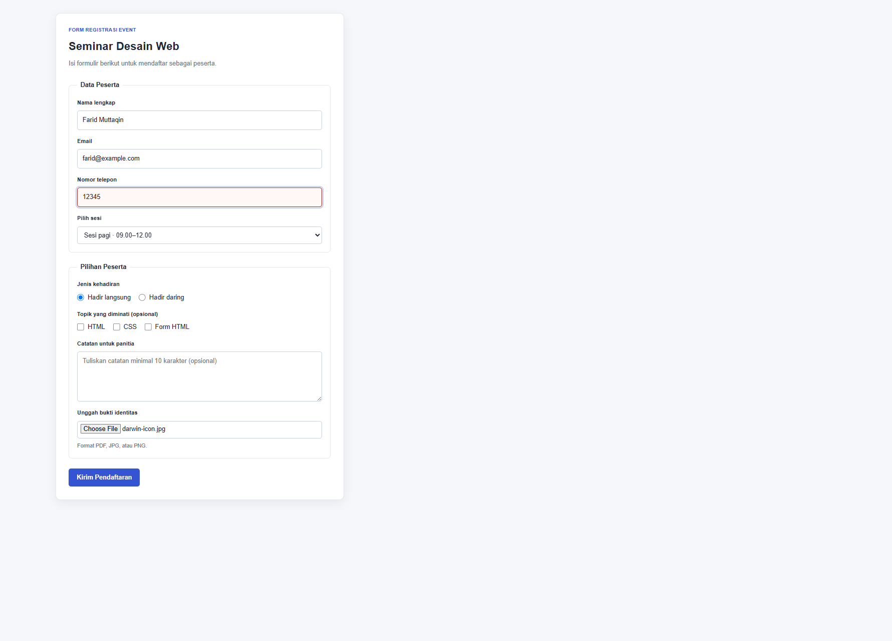
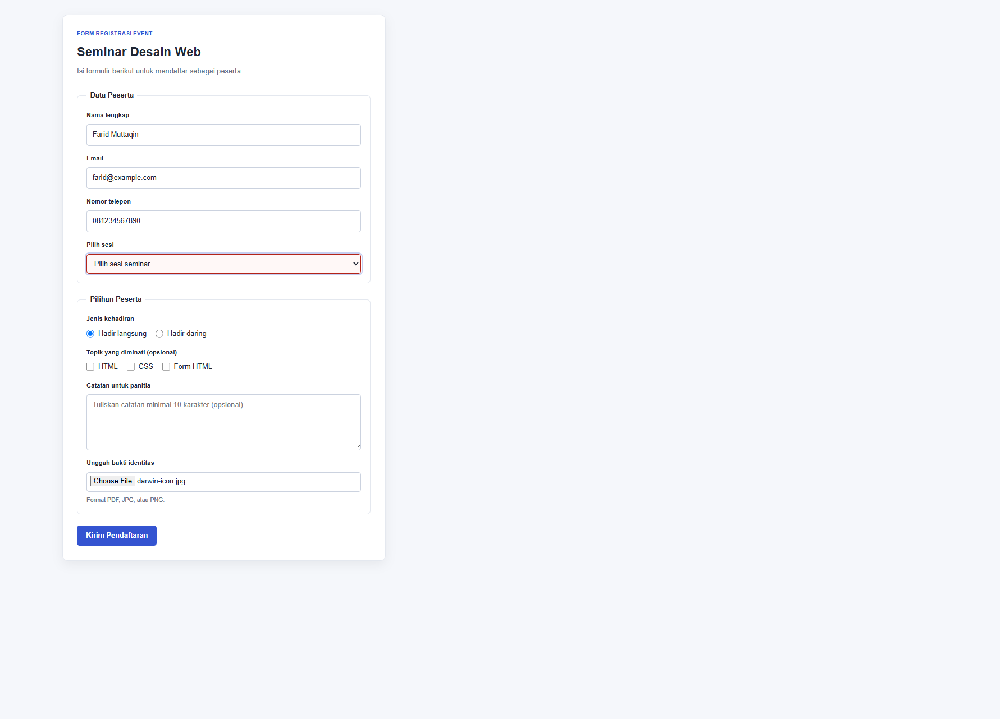
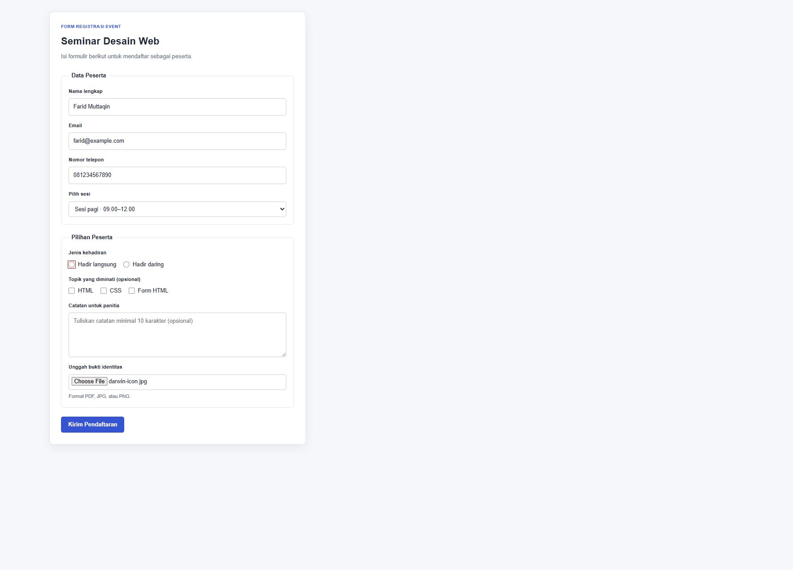
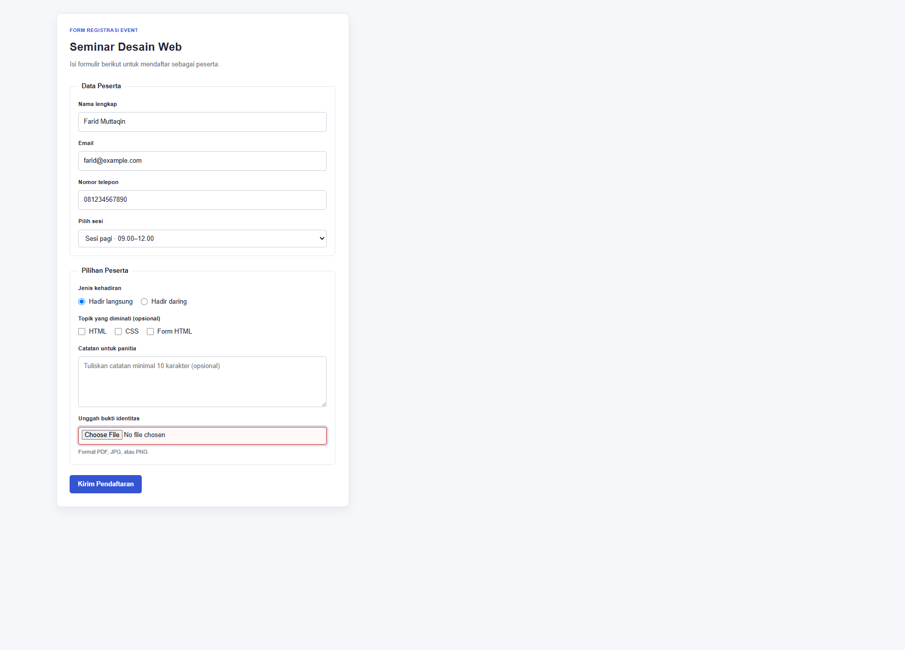
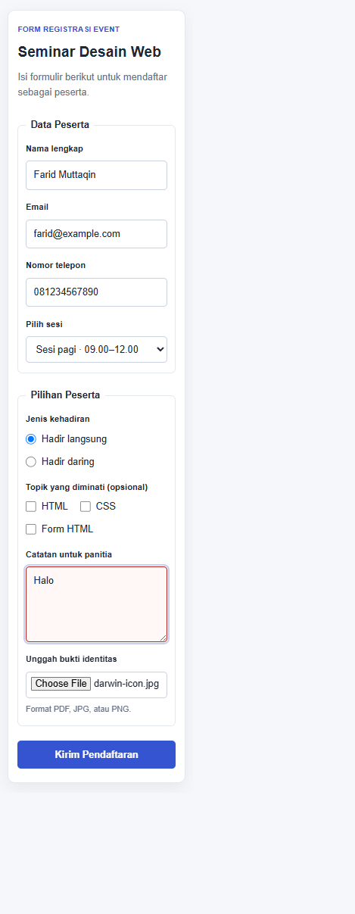

# Form Registrasi Event — Pertemuan 7

## Tugas

Membuat form registrasi event dengan radio, checkbox, select, textarea, dan
upload. Form dilengkapi validasi, pengujian minimal lima skenario input salah,
serta penjelasan validasi yang tetap harus dilakukan di server.

## Berkas

- `tugas.html` — struktur form registrasi dan validasi HTML.
- `css/style.css` — tampilan form desktop dan mobile.
- `dokumentasi/screenshots/` — screenshot form pada skenario input salah.

## Validasi form

1. Nama wajib diisi dan terdiri dari 3–60 karakter.
2. Email wajib diisi dengan format email.
3. Nomor telepon wajib terdiri dari 10–13 digit angka.
4. Sesi wajib dipilih.
5. Salah satu pilihan kehadiran wajib dipilih.
6. File bukti identitas wajib dipilih. Atribut `accept` menyarankan format
   PDF, JPG, JPEG, atau PNG pada pemilih file.
7. Catatan bersifat opsional; jika diisi, panjangnya 10–300 karakter.

Validasi tersebut menggunakan atribut HTML, seperti `required`, `type`,
`minlength`, `maxlength`, `pattern`, dan `accept`. Radio dipakai untuk satu
pilihan kehadiran, checkbox untuk topik yang diminati, select untuk sesi,
textarea untuk catatan, serta file input untuk bukti identitas.

## Test case validasi

| No. | Field | Input uji | Hasil yang diharapkan | Hasil aktual |
| --- | --- | --- | --- | --- |
| 1 | Nama | Kosong | Nama ditandai tidak valid. | Gagal validasi browser (`checkValidity() = false`). |
| 2 | Email | `farid@` | Format email ditandai tidak valid. | Gagal validasi browser (`checkValidity() = false`). |
| 3 | Nomor telepon | `12345` | Nomor ditandai tidak valid karena kurang dari 10 digit. | Gagal validasi browser (`checkValidity() = false`). |
| 4 | Sesi | Tidak memilih sesi | Sesi ditandai tidak valid. | Gagal validasi browser (`checkValidity() = false`). |
| 5 | Kehadiran | Tidak memilih radio | Pilihan kehadiran ditandai tidak valid. | Gagal validasi browser (`checkValidity() = false`). |
| 6 | Bukti identitas | Tidak memilih file | Bukti identitas ditandai tidak valid. | Gagal validasi browser (`checkValidity() = false`). |
| 7 | Catatan | `Halo` | Catatan ditandai tidak valid karena kurang dari 10 karakter. | Gagal validasi browser (`checkValidity() = false`). |

## Validasi di server

Validasi HTML di browser dapat dilewati, sehingga server tetap wajib memeriksa
field wajib, format email, panjang dan format nomor telepon, pilihan sesi dan
kehadiran, serta panjang catatan. Server juga harus memeriksa keberadaan,
ukuran, dan tipe file yang diunggah; atribut `accept` hanya membantu
membatasi pilihan file pada browser dan bukan pemeriksaan keamanan.

## Perubahan, masalah, dan solusi

Form dibuat menggunakan elemen dan validasi HTML sesuai materi. Saat menyiapkan
bukti, screenshot awal hanya memperlihatkan form kosong sehingga hasil setiap
skenario input salah tidak terlihat jelas di README. Saya menggantinya dengan
screenshot pengujian per skenario: data pada field lain valid, field yang
sedang diuji tidak valid, dan field tersebut difokuskan agar tandanya terlihat.

## Screenshot hasil pengujian

Setiap screenshot di bawah ini memperlihatkan hasil skenario input tidak valid.
Enam skenario diambil pada desktop dan satu skenario pada mobile.

### Desktop — Nama kosong



### Desktop — Format email salah



### Desktop — Nomor telepon kurang dari 10 digit



### Desktop — Sesi belum dipilih



### Desktop — Pilihan kehadiran belum dipilih



### Desktop — Bukti identitas belum dipilih



### Mobile — Catatan kurang dari 10 karakter



## Struktur

```text
tugas/
|-- tugas.html
|-- Readme.md
|-- css/
|   `-- style.css
`-- dokumentasi/
    `-- screenshots/
        |-- nama-kosong.png
        |-- email-salah.png
        |-- telepon-salah.png
        |-- sesi-kosong.png
        |-- kehadiran-kosong.png
        |-- bukti-kosong.png
        `-- catatan-terlalu-singkat-mobile.png
```
