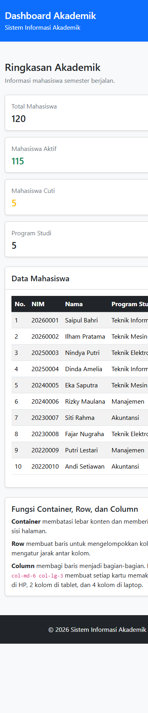
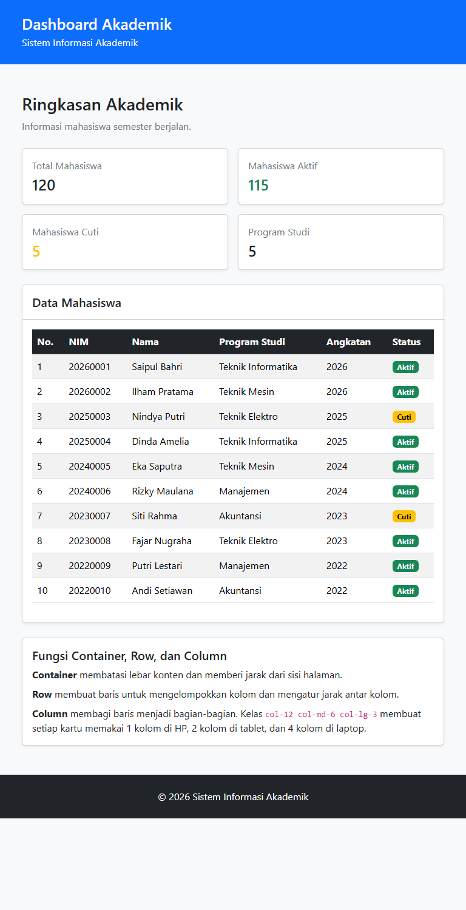
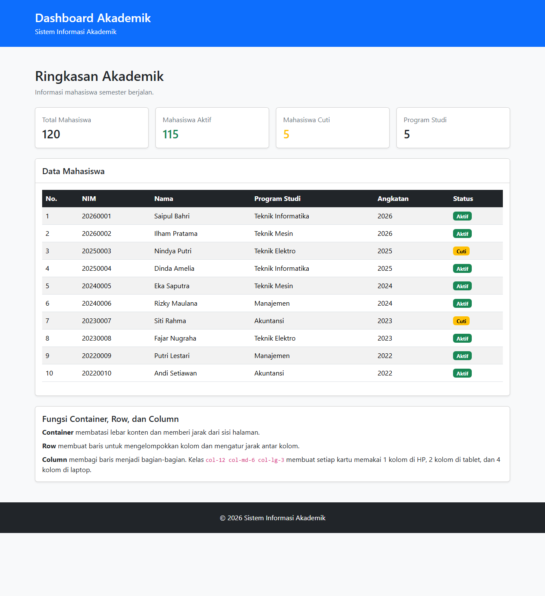

# Dashboard Akademik — Pertemuan 9

## Isi tugas

Dashboard dibuat menggunakan Bootstrap 5.3.8 melalui CDN dan mengikuti pola
grid serta tabel dari contoh Pertemuan 9.

- Empat kartu statistik berubah menjadi 1 kolom di HP, 2 kolom di tablet, dan
  4 kolom di laptop menggunakan `col-12 col-md-6 col-lg-3`.
- Tabel menampilkan 10 data mahasiswa dengan kelas `table-striped`,
  `table-hover`, dan `table-responsive`.
- Badge menunjukkan status mahasiswa.

## Fungsi container, row, dan column

- `container` membatasi lebar konten serta memberi jarak dari tepi halaman.
- `row` membuat baris untuk mengelompokkan kolom dan mengatur jarak antar kolom.
- `column` membagi baris menjadi bagian. Pada kartu statistik, `col-12`
  menampilkan satu kartu per baris di HP, `col-md-6` menampilkan dua kartu per
  baris di tablet, dan `col-lg-3` menampilkan empat kartu per baris di laptop.

## Utility class

Contoh utility class yang digunakan antara lain `bg-light`, `text-secondary`,
`mb-4`, `py-4`, dan `shadow-sm`. Class tersebut mengatur warna latar, warna
teks, jarak, dan bayangan tanpa menambahkan aturan CSS khusus untuk setiap
elemen.

## Perubahan, masalah, dan solusi

Dashboard menyatukan ringkasan statistik dan data mahasiswa dalam satu halaman.
Grid Bootstrap digunakan agar kartu berubah dari satu menjadi dua lalu empat
kolom sesuai ukuran layar.

Pada layar kecil, isi tabel lebih lebar daripada area yang tersedia. Tabel
ditempatkan di dalam `table-responsive` agar dapat digeser secara horizontal
tanpa membuat seluruh halaman melebar. `table-striped` membantu membedakan
baris, sedangkan `table-hover` menandai baris saat diarahkan.

## Bukti screenshot

Screenshot diambil untuk menunjukkan perubahan jumlah kolom pada tiga ukuran
layar.

### HP — 375 px

### Tablet — 768 px

### Laptop — 1280 px

